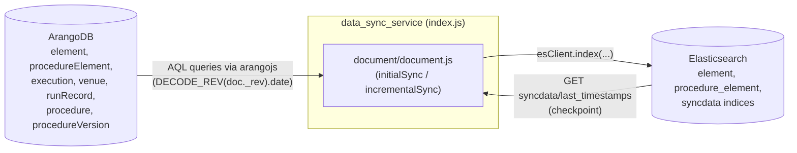
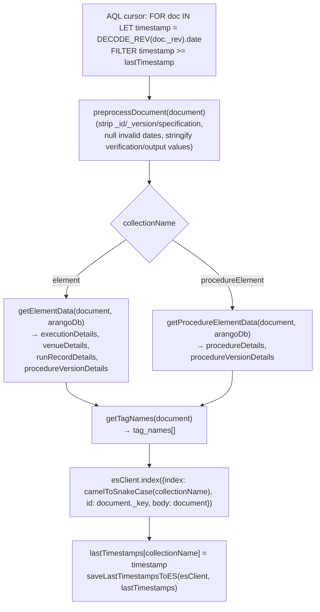
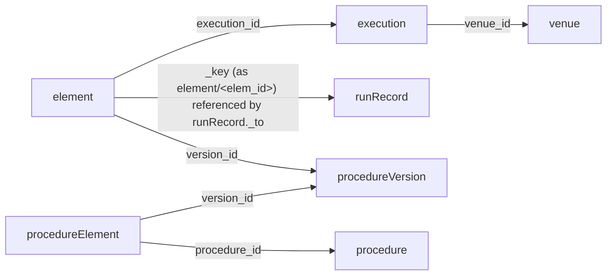

# Architecture

[← Home](./README.md) · See also: [Core Components](./Core-Components.md) · [Data Flow](./Data-Flow.md) · [Configuration](./Configuration.md)

## System context

`data_sync_service` is a standalone worker process with two external dependencies and no inbound network surface (no HTTP server, no CLI arguments, no message queue consumer). It only ever *initiates* connections outward.



- **Observed implementation:** the ArangoDB collection names (`element`, `procedureElement`) are hardcoded in `config/config.js` (`ARANGO_COLLECTION_NAMES`). The related collections `execution`, `venue`, `runRecord`, `procedure`, and `procedureVersion` are referenced by AQL string literals inside `document/document.js` (`getElementData`, `getProcedureElementData`) — they are not configurable.
- **Observed implementation:** the Elasticsearch index names are derived at runtime from the collection name via `camelToSnakeCase` (`utils/utils.js`), e.g. `element` → `element`, `procedureElement` → `procedure_element`. The checkpoint index name (`syncdata`) and document id (`last_timestamps`) are hardcoded in `utils/utils.js`.

## Components and responsibilities

| Component | File | Responsibility |
| --- | --- | --- |
| Entry point / orchestrator | `index.js` | Connects to ArangoDB & Elasticsearch with retries, runs one `initialSync` pass, then loops `incrementalSync` forever. |
| Configuration | `config/config.js` | Reads `process.env` once at module load and exports a frozen-by-convention (not `Object.freeze`d) config object. |
| Datastore clients | `db/db.js` | Two factory functions that construct an `arangojs` `Database` and an `@elastic/elasticsearch` `Client`. |
| Sync engine | `document/document.js` | Preprocessing/sanitization, denormalization queries, and the `initialSync`/`incrementalSync` algorithms. |
| Helpers | `utils/utils.js` | `sleep`, `camelToSnakeCase`, and the two functions that persist/read the sync checkpoint to/from Elasticsearch. |
| Logging | `utils/logger.js` | A single Winston logger instance, JSON-formatted, Console transport only. |

## Control flow (startup → steady state)

```mermaid
sequenceDiagram
    participant Idx as index.js (startService)
    participant Arango as ArangoDB
    participant ES as Elasticsearch
    participant Doc as document.js

    Note over Idx: Shared 5-minute budget (maxWaitMilisecs)\ncovers BOTH loops below
    loop every 5s until connected or budget exhausted
        Idx->>Arango: getArangoDb() + db.exists()
    end
    loop every 5s until connected or remaining budget exhausted
        Idx->>ES: getEsClient() + client.ping()
    end
    alt either connection failed
        Idx->>Idx: logger.error(...); return (process ends naturally)
    end
    Idx->>Idx: sleep(INIT_SYNC_DELAY_SECS)
    Idx->>ES: GET syncdata/last_timestamps
    Idx->>Doc: initialSync(lastTimestamps, arangoDb, esClient, collections)
    loop forever, every SYNC_INTERVAL_SECS
        Idx->>Doc: incrementalSync(lastTimestamps, arangoDb, esClient, collections)
    end
```

**Observed implementation, not a documentation assumption:** the two connection-retry `while` loops in `index.js` share a single `elapsedTime` clock computed from one `startTime`. The second loop (Elasticsearch) does **not** reset the timer — it continues counting from where the ArangoDB loop left off. So the "up to 5 minutes" described in the README is a combined budget for both connections together, not 5 minutes each. If ArangoDB takes 4 minutes to connect, Elasticsearch has only ~1 minute of retries left.

## Per-document processing (the sync engine)

`initialSync` and `incrementalSync` share the same per-document pipeline; they differ only in how they select which documents to process (see [Data Flow](./Data-Flow.md) for the exact AQL and chunking behavior).



Each denormalized sub-document (`execution`, `venue`, `runRecord`, `procedure`, `procedureVersion`) is itself passed through `preprocessDocument` before being attached — the sanitization pass runs on every document fetched from ArangoDB, not just the top-level one.

## Collection relationships (denormalization graph)

These are the ArangoDB relationships that `getElementData` and `getProcedureElementData` traverse via AQL `FILTER` joins:



## Why a revision-timestamp poll instead of a change stream

The service does not use ArangoDB's native change-stream/replication API. Instead, it polls with AQL using `DECODE_REV(doc._rev).date`, an ArangoDB built-in that decodes the document's internal revision id into the timestamp it was last written. Checkpointing this per-collection value (persisted in the ES `syncdata` index) makes the sync resumable after a restart without needing an external offset store.

**The repository does not document why this polling approach was chosen over ArangoDB's native replication/changes API.** This is the observed design; the rationale is not recorded in the code or README.

## Idempotency note (documented in-code)

The AQL filters use `timestamp >= @lastTimestamp` (inclusive), not `>`. The in-code comment in `document/document.js` explains why: *"Note that FILTER uses '>=' so as not to miss any new element with the same timestamp. We may re-index some of the same documents in ES, which is fine."* This is a deliberate, documented trade-off: at-least-once delivery into Elasticsearch, relying on `esClient.index` with a deterministic `id: document._key` to make repeat indexing idempotent.
