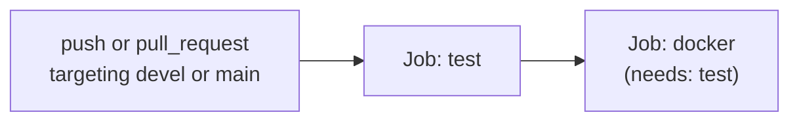

# CI/CD

[← Home](./README.md) · See also: [Testing](./Testing.md) · [Development](./Development.md)

CI is configured in this repository via GitHub Actions (`.github/workflows/ci.yml`).

## GitHub Actions — `.github/workflows/ci.yml`

**Triggers:** `push` and `pull_request` events targeting branches `devel` and `main` only.

**Concurrency:** `group: ${{ github.workflow }}-${{ github.ref }}`, `cancel-in-progress: true` — a new push to the same branch/PR cancels any still-running run for that ref.

**Permissions:** `contents: read` only (no write/deploy permissions granted to this workflow).

### Job: `test`

Runs on `ubuntu-latest`:
1. `actions/checkout@v5`
2. `actions/setup-node@v5` with `node-version-file: '.nvmrc'` and `cache: 'npm'` — i.e. the exact Node version is whatever `.nvmrc` specifies (currently `24.22.1`), not hardcoded in the workflow itself.
3. `npm ci`
4. `npm run test:coverage` — this is the same command documented in [Testing](./Testing.md); it fails the job if the 100% coverage threshold isn't met.

### Job: `docker`

Runs on `ubuntu-latest`, `needs: test` (only runs if `test` succeeds):
1. `actions/checkout@v5`
2. `docker build -t data_sync_service:${{ github.sha }} .`

**Observed implementation:** the `docker` job only *builds* the image tagged with the commit SHA — there is no push/publish step to any container registry in this workflow. No release or deployment automation is defined in `ci.yml`.

## Release / versioning

No semantic-release, tag-triggered publish workflow, or changelog automation is present. `package.json`'s `version` field is a static `"1.0.0"`. Releasing/deploying beyond the Docker build step above is not automated in this repository as far as can be established from its files.
