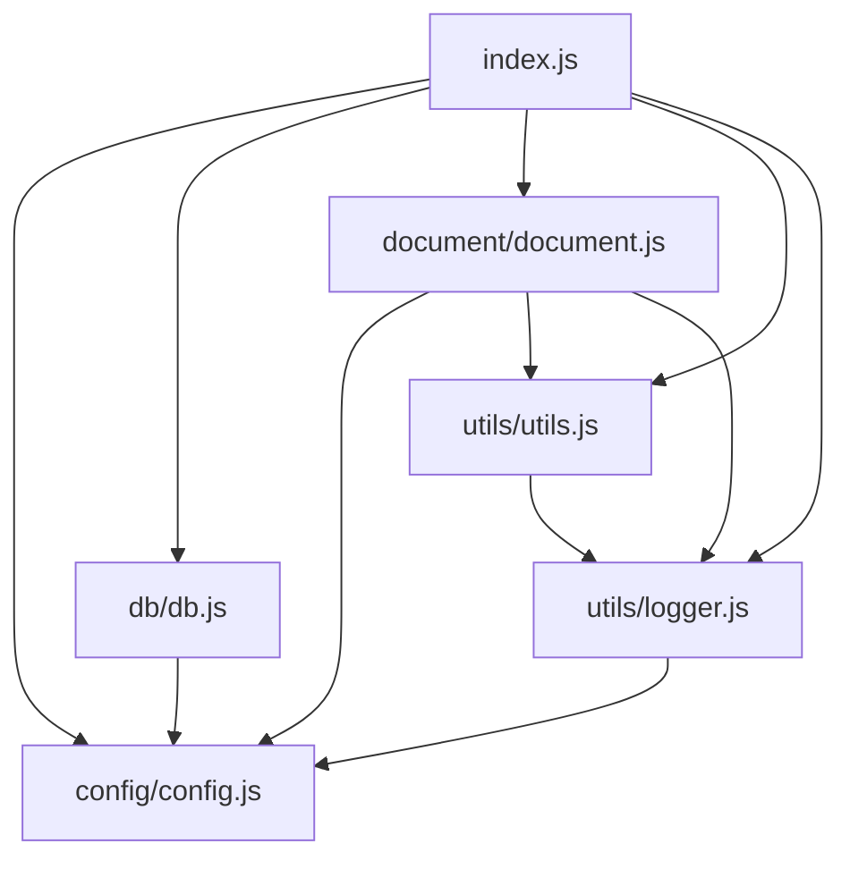

# Repository Structure

[← Home](./README.md)

This page explains what each part of the repository is responsible for and how the pieces relate to one another. See [Architecture](./Architecture.md) for how they interact at runtime, and [Core Components](./Core-Components.md) for a deep dive into each module's implementation.

```text
.
├── index.js                # Entry point: connection retry, startup orchestration, sync loop
├── config/
│   └── config.js           # Reads process.env once at require-time, exports config constants
├── db/
│   └── db.js                # Factory functions that construct the ArangoDB and ES client instances
├── document/
│   └── document.js          # The sync engine: preprocessing, denormalization, initialSync, incrementalSync
├── utils/
│   ├── logger.js             # Winston logger, single-line JSON output
│   └── utils.js               # sleep(), camelToSnakeCase(), ES checkpoint read/write helpers
├── tests/unit/
│   ├── *.test.js              # One Jest test file per module (config, db, document, index, logger, utils)
│   └── mocks/                 # Shared test doubles for ArangoDB, Elasticsearch, and env snapshotting
├── .github/workflows/ci.yml   # GitHub Actions: test job + Docker build job
├── Dockerfile                   # Production image build (installs only prod deps)
├── jest.config.js                # Jest test matcher + 100% coverage threshold
├── package.json / package-lock.json  # Dependencies, npm scripts, engines constraint
├── .nvmrc                          # Pins local Node version (24.22.1)
├── .dockerignore / .gitignore       # Build/VCS exclusions
└── coverage/                        # Generated by `npm run test:coverage` (gitignored)
```

## How the pieces relate

`index.js` is the only module that is meant to be *run*; every other module is a library consumed by it (or by the test suite). The dependency direction is one-way and shallow:



- **`config/config.js`** has no internal dependencies — it only reads `process.env`. Every other internal module depends on it (directly or transitively through `logger`), which is why it sits at the bottom of the graph.
- **`db/db.js`** depends only on `config` and the two external database client libraries (`arangojs`, `@elastic/elasticsearch`). It has no knowledge of sync logic.
- **`document/document.js`** is the largest module and contains all business logic: denormalization, sanitization, and the two sync algorithms (`initialSync`, `incrementalSync`). It depends on `config` (for sync tuning constants) and `utils` (for `camelToSnakeCase` and checkpoint persistence).
- **`utils/utils.js`** provides small, reusable helpers, including the two functions that read/write the sync checkpoint document in Elasticsearch (`readLastTimestampsFromES`, `saveLastTimestampsToES`).
- **`utils/logger.js`** is a leaf dependency used by everything except `config.js` itself.

## `tests/unit/`

Each production module has a corresponding `*.test.js` file (`config.test.js`, `db.test.js`, `document.test.js`, `index.test.js`, `logger.test.js`, `utils.test.js`). The `tests/unit/mocks/` directory holds three shared test doubles, detailed in [Testing](./Testing.md):

- `mockDatabase.js` — `makeArangoDb({ queryImpl, exists })`
- `mockSearchClient.js` — `makeEsClient({ ping, getImpl, indexImpl })`
- `testHelpers.js` — `makeCursor(items, count)` (mimics an ArangoDB cursor's `hasNext`/`next()` contract) and `snapshotEnv()` (restores `process.env` between tests)

## Generated / non-source directories

- **`coverage/`** — Istanbul/Jest HTML + `lcov` coverage report, produced by `npm run test:coverage`. Gitignored (see `.gitignore`).
- **`node_modules/`** — npm-installed dependencies, gitignored and dockerignored.

## Files intentionally excluded from the Docker image

`.dockerignore` excludes `tests`, `coverage`, `jest.config.js`, `docs`, and `*.md` from the production image built by `Dockerfile` — i.e. this wiki (`docs/`) and the README are development-time artifacts only, not shipped in the runtime container.
